# PetCare: sistema de consola para una clínica veterinaria

Aplicación de consola desarrollada en Java que permite gestionar las actividades principales de una clínica veterinaria: registrar dueños y sus mascotas (perros, gatos y aves exóticas), registrar veterinarios, agendar citas, atender o cancelar citas, generar comprobantes de cobro y consultar historiales clínicos.

El proyecto aplica los principios de Diseño y Programación Orientada a Objetos (POO), incluyendo herencia, abstracción, interfaces, polimorfismo, encapsulamiento, composición, agregación y asociación.

> Proyecto del Examen Parcial Integrador de la EE Diseño y Programación Orientada a Objetos, Licenciatura en Ingeniería de Software, Universidad Veracruzana (agosto 2026 – enero 2027).

## Contenido

1. [Tecnologías](#tecnologías)
2. [Modelo de la solución](#modelo-de-la-solución)
3. [Estructura del proyecto](#estructura-del-proyecto)
4. [Conceptos aplicados](#conceptos-aplicados)
5. [Instalación y ejecución](#instalación-y-ejecución)
6. [Ejemplo de uso](#ejemplo-de-uso)
7. [Reglas de negocio](#reglas-de-negocio)
8. [Reflexión](#reflexión)
9. [Autor](#autor)

## Tecnologías

| Herramienta | Uso |
| --- | --- |
| Java 26 (OpenJDK) | Lenguaje de programación |
| IntelliJ IDEA | Entorno de desarrollo |
| draw.io | Elaboración de diagramas UML |
| Git | Control de versiones |
| GitHub | Almacenamiento y seguimiento del proyecto |

## Modelo de la solución

### Diagrama de clases

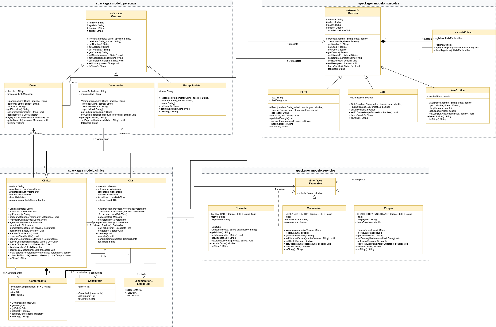

### Diagrama de casos de uso

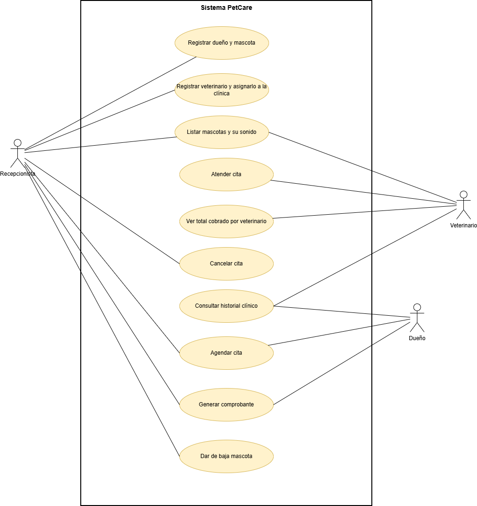

El análisis completo de las clases, los objetos de ejemplo y la justificación de las relaciones se encuentra en [`docs/analisis.md`](docs/analisis.md).

### Decisiones de diseño

- **Herencia con clase abstracta (personas):** se creó la clase abstracta `Persona`, que contiene los atributos y métodos comunes de dueños, veterinarios y recepcionistas. Las clases `Dueno`, `Veterinario` y `Recepcionista` heredan sus características y agregan sus propios atributos.

- **Herencia con clase abstracta (mascotas):** la clase abstracta `Mascota` contiene los datos comunes de los animales y declara el método abstracto `hacerSonido()`. Las clases `Perro`, `Gato` y `AveExotica` implementan este método de manera diferente.

- **Interfaz `Facturable`:** se utiliza para establecer un contrato que obliga a los servicios `Consulta`, `Vacunacion` y `Cirugia` a implementar el método `calcularCosto()`. Esto permite que cada servicio calcule su precio de acuerdo con sus propias características.

- **Composición entre `Mascota` e `HistorialClinico`:** cada mascota crea su propio historial clínico al construirse. El historial pertenece a la mascota.

- **Composición entre `Clinica` y `Consultorio`:** la clínica crea sus consultorios durante su construcción y administra su existencia.

- **Agregación entre `Clinica` y `Veterinario`:** los veterinarios se crean de manera independiente y posteriormente se agregan a la clínica mediante `agregarVeterinario()`.

- **Asociaciones:** las clases `Dueno` y `Mascota` mantienen referencias entre sí. Por otra parte, `Cita` se relaciona con una mascota, un veterinario, un consultorio y un servicio facturable.

- **Responsabilidades:** la clase `Clinica` coordina las operaciones principales y las reglas de agenda, mientras que cada clase se encarga de validar sus propios atributos y comportamientos.

## Estructura del proyecto

```text
petcare-poo-java/
├── README.md
├── .gitignore
├── docs/
│   ├── analisis.md
│   ├── escenario-demostracion.md
│   ├── diagramas/
│   │   ├── diagrama-clases.drawio
│   │   ├── diagrama-clases.png
│   │   ├── diagrama-casos-uso.drawio
│   │   └── diagrama-casos-uso.png
│   └── capturas/
│       ├── captura1.jpg
│       ├── captura2.jpg
│       ├── ...
│       └── captura12.jpg
└── src/
    ├── app/
    │   └── Main.java
    └── modelo/
        ├── personas/
        ├── mascotas/
        ├── servicios/
        └── clinica/
```

### Descripción de los paquetes

| Paquete | Propósito |
| --- | --- |
| `app` | Contiene la clase Main, el menú principal y la interacción con el usuario. |
| `modelo.personas` | Contiene Persona, Dueno, Veterinario y Recepcionista. |
| `modelo.mascotas` | Contiene Mascota, Perro, Gato, AveExotica e HistorialClinico. |
| `modelo.servicios` | Contiene Facturable, Consulta, Vacunacion y Cirugia. |
| `modelo.clinica` | Contiene Clinica, Cita, EstadoCita, Comprobante y Consultorio. |

## Conceptos aplicados

A continuación se muestran algunos de los conceptos de Programación Orientada a Objetos utilizados en el proyecto y su ubicación dentro del código fuente.

| Tema | Archivo | Líneas |
| --- | --- | --- |
| Herencia de personas | `modelo/personas/Veterinario.java` | 7-24 |
| Herencia de mascotas | `modelo/mascotas/Perro.java` | 9-28 |
| Clase abstracta | `modelo/personas/Persona.java` | 7-16 |
| Clase abstracta y método abstracto | `modelo/mascotas/Mascota.java` | 9-18, 118 |
| Interfaz | `modelo/servicios/Facturable.java` | 7-14 |
| Implementación de interfaz | `Consulta.java`, `Vacunacion.java`, `Cirugia.java` | Línea 7 de cada clase |
| Polimorfismo con mascotas | `app/Main.java` | 289-300 |
| Polimorfismo con servicios facturables | `modelo/clinica/Comprobante.java` | 22-30 |
| Sobrecarga de constructores | `modelo/servicios/Consulta.java` | 16-30 |
| Sobrecarga de métodos | `modelo/clinica/Clinica.java` | 158-182 |
| Constructor por defecto y constructor con parámetros | `modelo/servicios/Consulta.java` | 16-30 |
| Uso de `super()` | `modelo/mascotas/Perro.java` | 24-28 |
| Sobreescritura con `@Override` | `Perro.java`, `Consulta.java`, `Comprobante.java` | 75-86, 76-86, 68-74 |
| Composición | `modelo/mascotas/Mascota.java` | 14-26 |
| Composición | `modelo/clinica/Clinica.java` | 45-48 |
| Agregación | `modelo/clinica/Clinica.java` | 61-73 |
| Asociación | `modelo/clinica/Cita.java` | 15-43 |
| Atributos y métodos `static` | `modelo/clinica/Comprobante.java` | 8-10, 64-66 |
| Constantes `static final` | `Consulta.java`, `Vacunacion.java`, `Cirugia.java` | 8, 10, 10 |
| Modificadores de acceso | `Persona.java`, `Mascota.java`, `HistorialClinico.java` | 7-18, 9-18, 12-17 |
| Creación y eliminación de referencias a objetos | `modelo/clinica/Clinica.java` | 197-213 |
| Encapsulamiento y validaciones | Setters de las clases del modelo | Por ejemplo, `Persona.java`, 65-119 |

### Explicación de los conceptos

**Herencia:** permite reutilizar atributos y métodos de una clase padre. En PetCare, `Veterinario`, `Dueno` y `Recepcionista` heredan de `Persona`. De igual manera, `Perro`, `Gato` y `AveExotica` heredan de `Mascota`.

**Abstracción:** se utiliza para representar características generales sin crear objetos de una clase demasiado genérica. Por eso `Persona` y `Mascota` son clases abstractas.

**Encapsulamiento:** los atributos se mantienen protegidos mediante modificadores de acceso y se utilizan métodos getters y setters para consultar o modificar la información. Los setters también validan que los datos sean correctos.

**Polimorfismo:** permite utilizar una referencia del tipo padre para trabajar con objetos de diferentes clases hijas. Por ejemplo, una lista de tipo `Mascota` puede contener perros, gatos y aves exóticas, y cada uno ejecuta su propia implementación de `hacerSonido()`.

**Interfaces:** `Facturable` establece el método `calcularCosto()`, que implementan los diferentes servicios de la clínica.

**Composición:** representa una relación fuerte entre objetos. Una mascota crea su historial clínico y la clínica crea sus consultorios.

**Agregación:** permite que una clase agrupe objetos que pueden existir independientemente. La clínica recibe veterinarios que ya fueron creados.

**Asociación:** representa la relación entre objetos que se conocen o colaboran entre sí, como sucede entre una cita, su mascota y su veterinario.

## Instalación y ejecución

### Requisitos

- Tener instalado Java JDK 26 o superior.
- Tener Git instalado.
- Contar con un entorno de desarrollo como IntelliJ IDEA o utilizar la terminal.

### Clonar el repositorio

Abrir una terminal y ejecutar:

```bash
git clone https://github.com/SaelJGS/petcare-poo-java.git
```

Entrar a la carpeta del proyecto:

```bash
cd petcare-poo-java
```

### Compilar y ejecutar

**Windows (PowerShell):**

```powershell
New-Item -ItemType Directory -Force out
javac -d out (Get-ChildItem -Recurse src -Filter *.java).FullName
java -cp out app.Main
```

**Git Bash, Linux o macOS:**

```bash
mkdir -p out
javac -d out $(find src -name "*.java")
java -cp out app.Main
```

Al ejecutar el programa se mostrará un menú de consola con 10 opciones. El menú permite administrar los registros de la clínica y permanece activo hasta que el usuario selecciona la opción 10 para salir.

## Ejemplo de uso

El programa cuenta con un escenario de demostración que incluye el registro de dueños, mascotas, veterinarios, citas, comprobantes y consultas de información.

Las 12 capturas de pantalla de la ejecución se encuentran en [`docs/escenario-demostracion.md`](docs/escenario-demostracion.md).

### 1. Menú principal

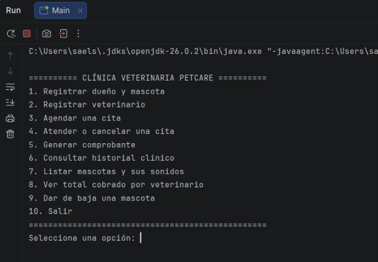

Permite acceder a las diferentes funcionalidades del sistema.

### 2. Validación de entradas

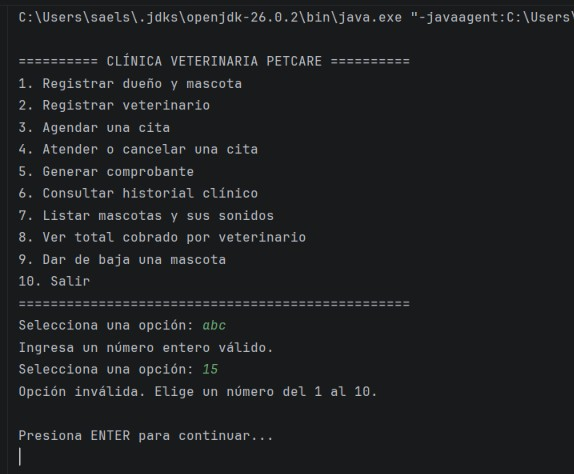

El programa valida los datos ingresados y muestra mensajes cuando se introduce información incorrecta.

### 3. Registro de dueños y mascotas

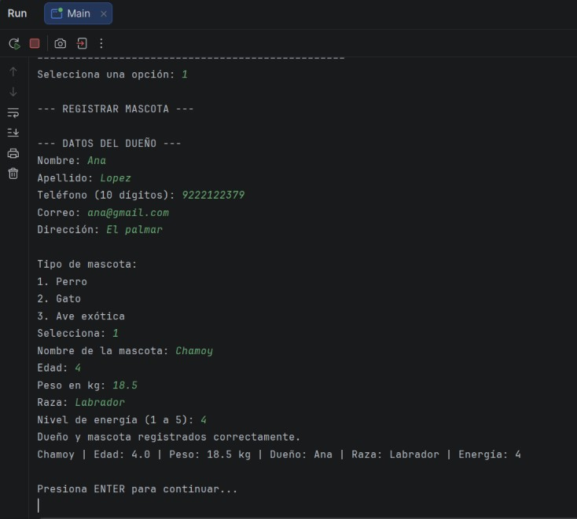

Se registran dueños y diferentes tipos de mascotas.

### 4. Registro de veterinarios

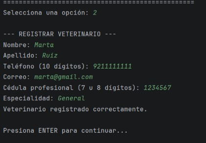

Se agregan veterinarios a la clínica.

### 5. Citas agendadas

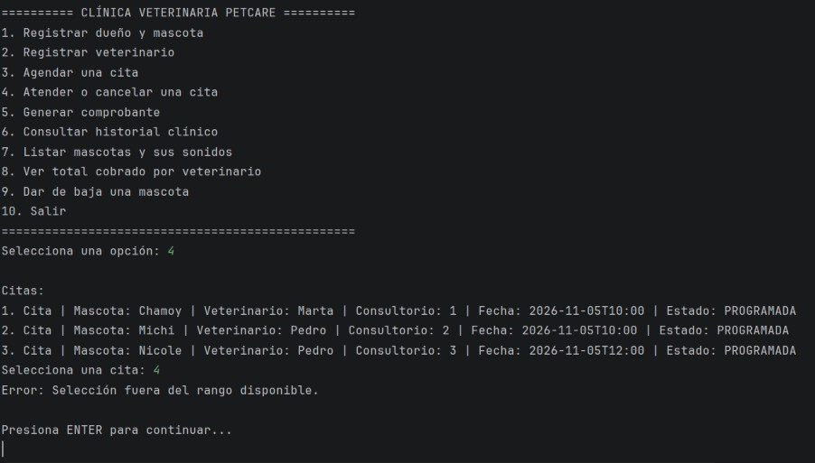

Se registran citas con diferentes servicios: consulta, vacunación y cirugía.

### 6. Validación de horarios

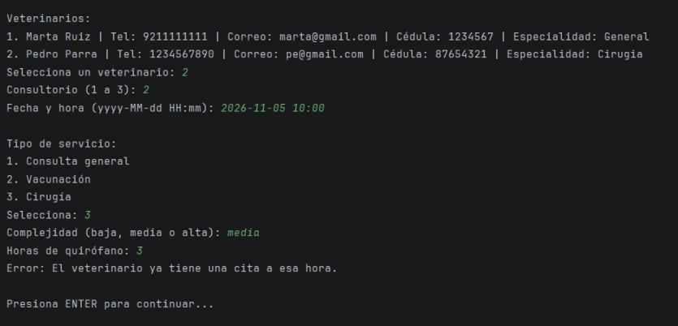

El sistema evita que un veterinario tenga dos citas programadas a la misma hora.

### 7. Validación de estados

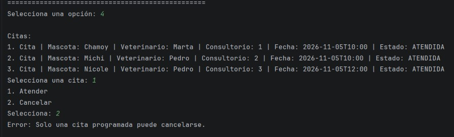

Se demuestra que una cita atendida no puede cancelarse.

### 8. Generación de comprobantes

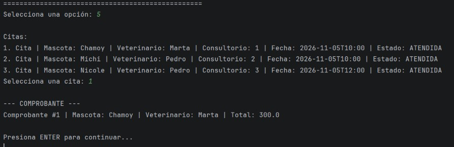

Al atender una cita se genera un comprobante con su folio y el total cobrado.

### 9. Polimorfismo

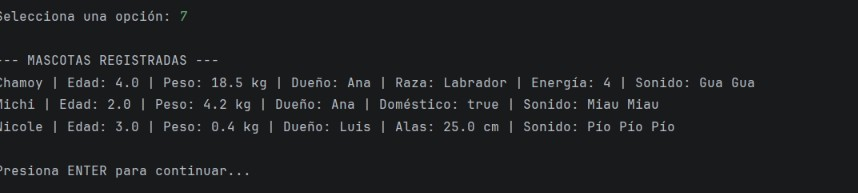

Cada tipo de mascota responde con su propio sonido mediante el método `hacerSonido()`.

### 10. Total cobrado por veterinario

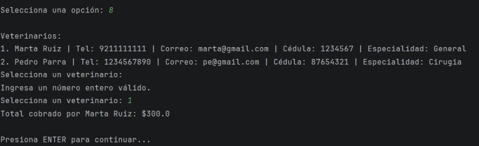

El sistema calcula el total de los comprobantes asociados a cada veterinario.

### 11. Historial clínico

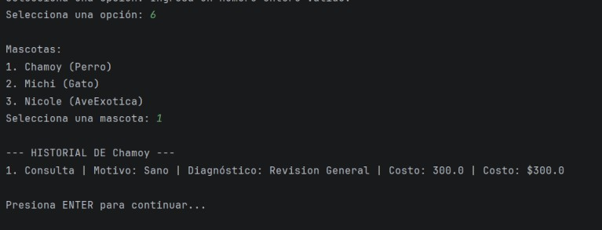

Cada mascota mantiene un historial de los servicios que ha recibido.

### 12. Baja de mascotas

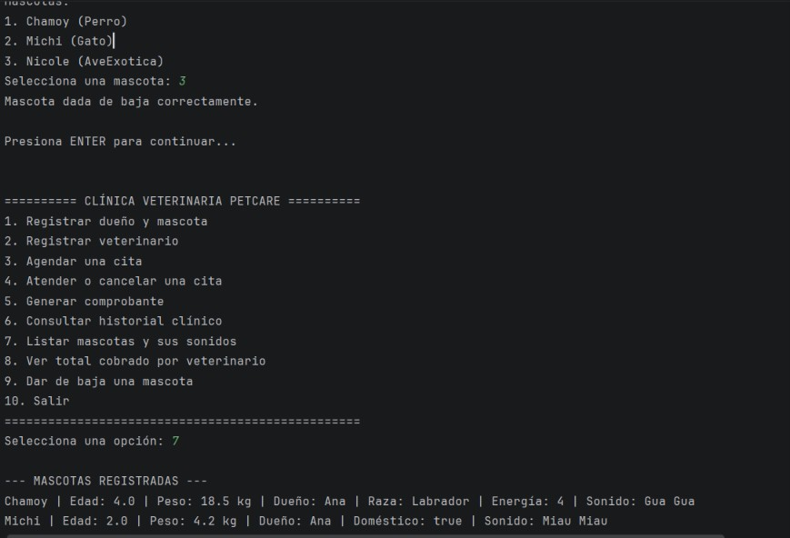

Al dar de baja una mascota se cancelan sus citas programadas y deja de aparecer en el registro de mascotas de su dueño.

## Reglas de negocio

El sistema incorpora validaciones para mantener la información consistente y evitar operaciones incorrectas.

Las principales reglas implementadas son:

| Regla | Descripción |
| --- | --- |
| Edad y peso | Deben ser mayores que cero. |
| Datos personales | El nombre y apellido son obligatorios. |
| Teléfono | Debe contener exactamente 10 dígitos. |
| Correo electrónico | Debe cumplir con el formato validado por el sistema. |
| Cédula profesional | Debe contener 7 u 8 dígitos. |
| Turno del recepcionista | Solo se permiten los turnos matutino, vespertino o nocturno. |
| Citas de veterinarios | Un veterinario no puede tener dos citas programadas a la misma hora. |
| Consultorios | Un consultorio no puede utilizarse en dos citas al mismo tiempo. |
| Estados de las citas | Solo las citas programadas pueden atenderse o cancelarse. |
| Comprobantes | Únicamente las citas atendidas pueden generar comprobantes. |
| Costos | Los costos de los servicios no pueden ser negativos. |
| Cirugías | La complejidad debe ser baja, media o alta. |
| Historial clínico | No se pueden agregar registros nulos. |
| Baja de mascotas | Se cancelan las citas programadas de la mascota antes de quitarla del registro de su dueño. |

Las validaciones se realizan principalmente mediante setters y métodos de las clases correspondientes. Cuando se detecta un dato incorrecto se lanza una excepción `IllegalArgumentException`, mientras que las operaciones que no corresponden al estado actual de una cita generan `IllegalStateException`.

La clase `Main` captura estas excepciones para mostrar mensajes al usuario y permitir que el programa continúe funcionando.

## Reflexión

### Qué aprendí

Durante el desarrollo de este proyecto comprendí mejor cómo aplicar la programación orientada a objetos en un problema más completo. Aprendí que no se trata solamente de crear clases y objetos, sino de identificar correctamente las responsabilidades de cada clase y la manera en que se relacionan.

Uno de los aprendizajes más importantes fue comprender la diferencia entre herencia, asociación, agregación y composición. También entendí mejor la utilidad de las clases abstractas y las interfaces, ya que permiten organizar el código y reutilizar comportamientos sin depender de una sola implementación.

Además, reforcé el uso de encapsulamiento, constructores, métodos sobrecargados, excepciones y colecciones de objetos.

### Qué fue lo más difícil

Una de las partes más difíciles fue diseñar correctamente las relaciones entre las clases, especialmente distinguir cuándo utilizar composición, agregación o asociación.

También fue un reto implementar las reglas de negocio de las citas, ya que era necesario comprobar que los veterinarios y consultorios estuvieran disponibles y controlar los cambios de estado para evitar operaciones inválidas.

Otro aspecto que requirió atención fue organizar el proyecto en paquetes y mantener una separación adecuada entre la lógica del sistema y la interacción con el usuario.

### Qué mejoraría

Como posibles mejoras, se podría implementar almacenamiento permanente de la información mediante una base de datos para evitar perder los registros al cerrar el programa.

También sería útil incorporar pruebas automatizadas, mejorar los reportes de cobros y agregar nuevas funcionalidades para administrar inventario de medicamentos y disponibilidad de los veterinarios.

### Uso de inteligencia artificial

Durante el desarrollo utilicé Claude como herramienta de apoyo para comprender conceptos de programación orientada a objetos, revisar el diseño de las clases y resolver problemas que fueron apareciendo durante la implementación.

La utilicé principalmente para:

- Comprender las diferencias entre asociación, agregación y composición.
- Entender cuándo conviene utilizar una interfaz o una clase abstracta.
- Revisar el análisis de clases y mejorar la documentación.
- Recibir orientación para elaborar los diagramas UML.
- Revisar el código y comprender errores de programación.
- Conocer ejemplos de validaciones, expresiones regulares, estructuras `switch` y atributos `static`.
- Mejorar comentarios, documentación Javadoc y organización del código.
- Resolver dudas relacionadas con Git, GitHub y la configuración del proyecto.

El uso de esta herramienta me permitió comprender mejor algunos temas y encontrar soluciones a problemas que no sabía cómo resolver. Sin embargo, fue necesario revisar las propuestas y adaptarlas al funcionamiento y a los requisitos del proyecto.

## Autor

**Sael de Jesús Garduza Santos**

Estudiante de Ingeniería de Software  
Universidad Veracruzana.

GitHub: [SaelJGS](https://github.com/SaelJGS)

Repositorio del proyecto: [petcare-poo-java](https://github.com/SaelJGS/petcare-poo-java)