# Escenario de demostración

Ejecución del escenario obligatorio del examen con el menú de consola de PetCare.

## 1. Menú principal

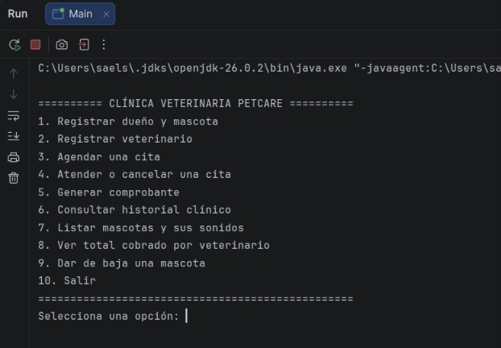

El menú se repite hasta que el usuario elige la opción 10.

## 2. Validación de entradas

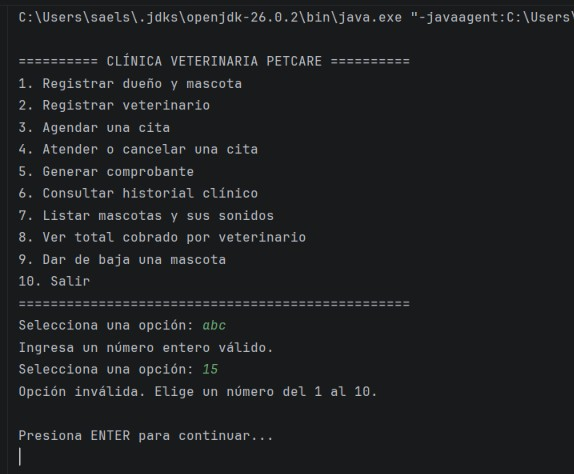

Un texto donde se espera un número y una opción fuera del menú muestran un aviso y el programa continúa.

## 3. Registro de dueños y mascotas

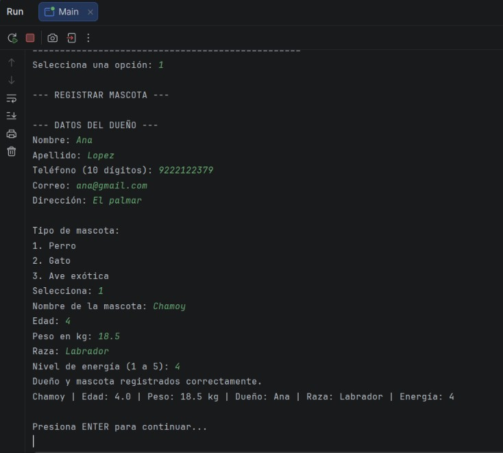

Se registran dos dueños y tres mascotas: un perro, un gato y un ave exótica.

## 4. Registro de veterinarios

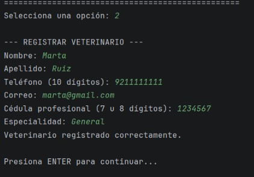

Se registran dos veterinarios y se agregan a la clínica.

## 5. Citas agendadas

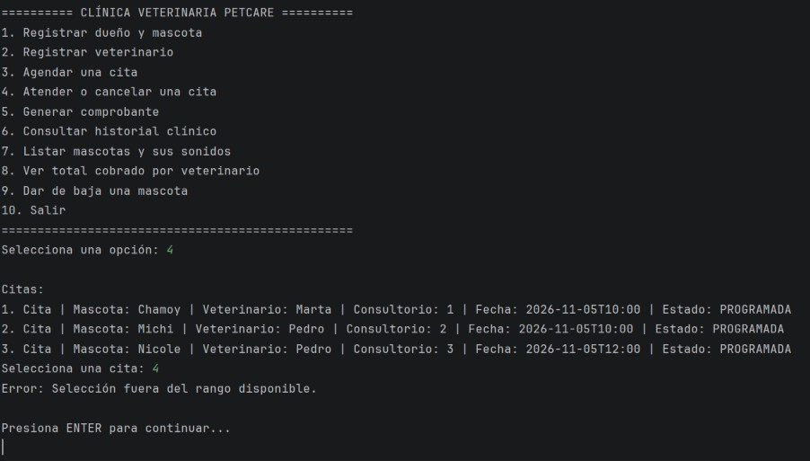

Se agendan tres citas: una consulta, una vacunación y una cirugía.

## 6. Regla de negocio violada

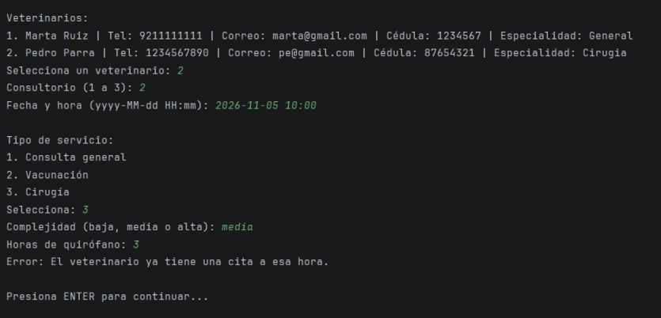

Un veterinario no puede tener dos citas programadas a la misma hora. El sistema rechaza la cita con un mensaje claro.

## 7. Estado inválido de una cita

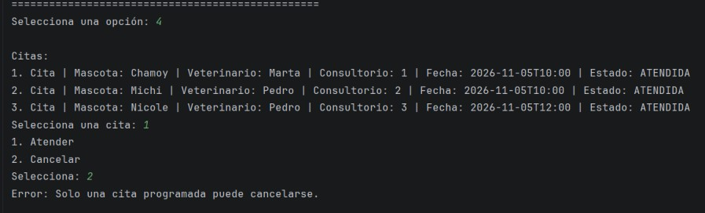

Una cita que ya fue atendida no puede cancelarse.

## 8. Comprobante

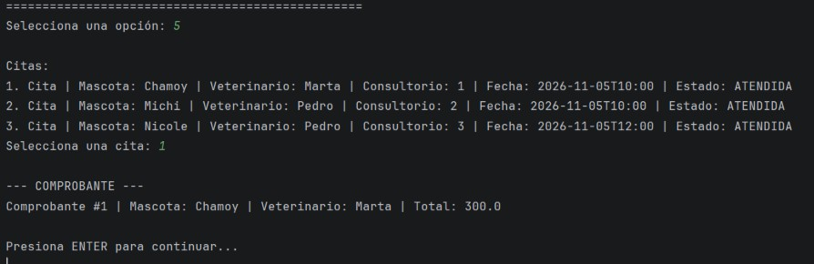

Al atender la cita se genera un comprobante con folio, mascota, veterinario y total.

## 9. Polimorfismo

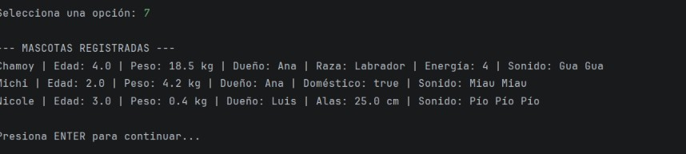

Una lista de `Mascota` llama a `hacerSonido()` y cada tipo responde con su propio sonido, sin usar `instanceof`.

## 10. Total cobrado por veterinario

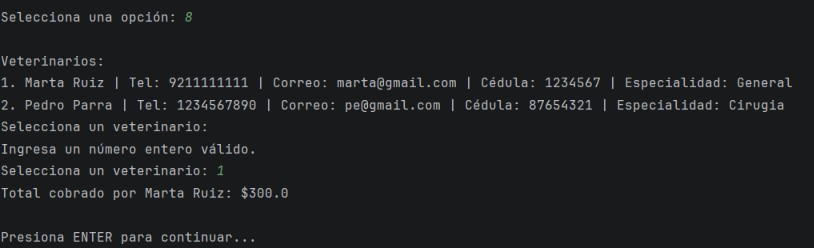

La clínica suma los comprobantes de las citas de cada veterinario.

## 11. Historial clínico

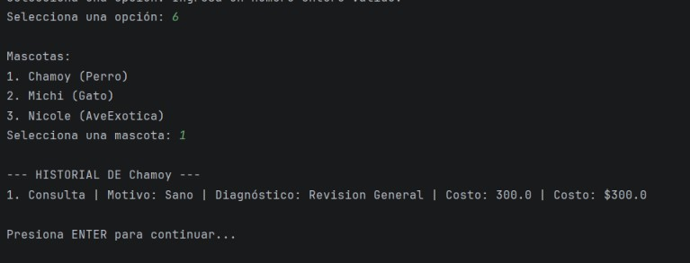

Cada mascota guarda en su historial los servicios que ha recibido.

## 12. Baja de una mascota

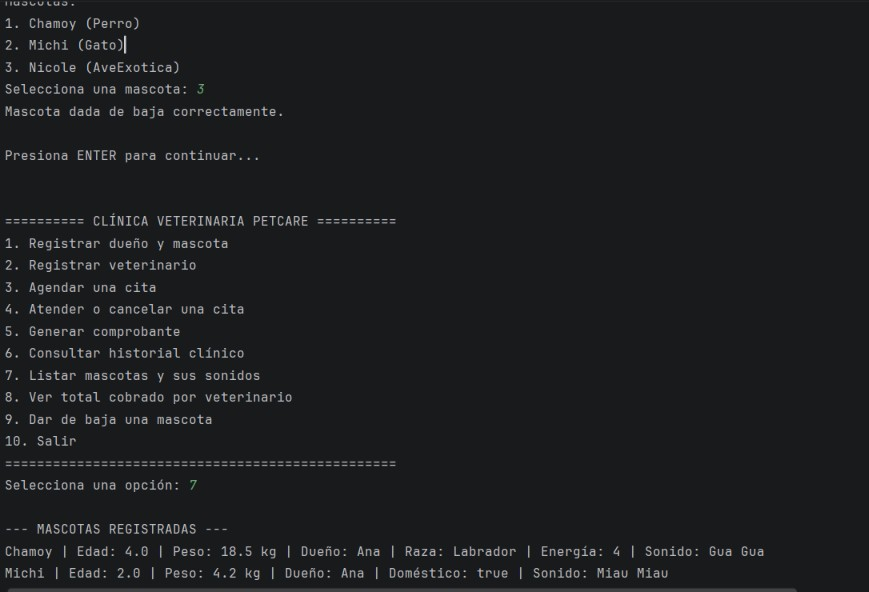

Al dar de baja una mascota se cancelan sus citas programadas y deja de aparecer en la lista.